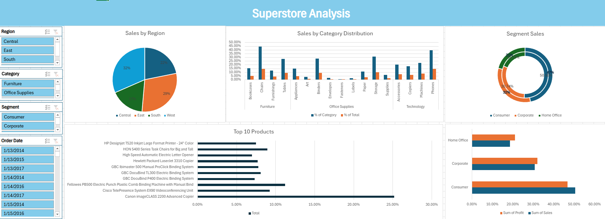
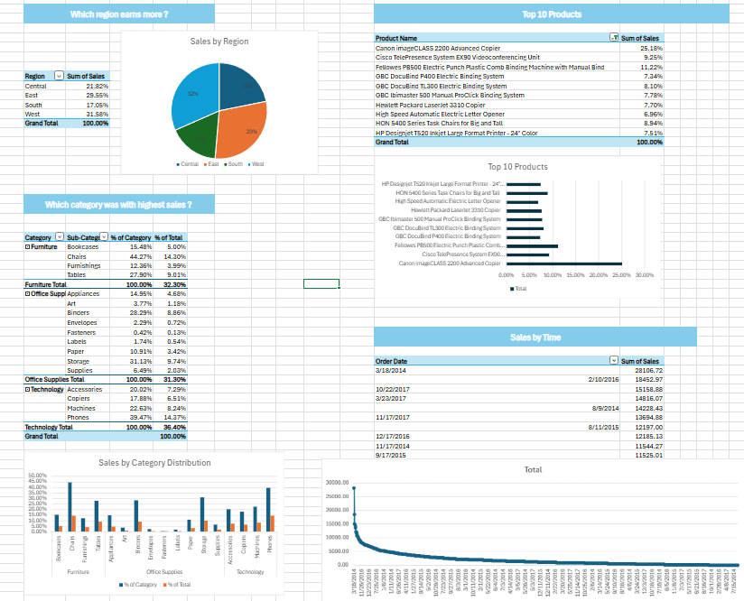

## Superstore Analysis

- Analyzed 9,994 order lines of US retail data (2014–2017, 5,009 orders and 793 customers) covering sales, profit, discount,
segment, region, and product category.
- Added an Order Year helper column, built 5 PivotTables with 4 slicers, and designed an interactive dashboard with a region
pie chart, category bar chart, top-10 products chart, segment doughnut, category treemap, and sales trend line.
- Key insights:
  1. $2.3M in sales and $286K profit (12.5% margin)
  2. Sales grew 51% from $484K (2014) to $733K (2017)
  3. Technology leads at $836K
  4. Furniture earns only a 2.5% margin vs. about 17% for Office Supplies and Technology
  5. Orders with 30%+ discounts produced a combined loss of about $135K.
---

